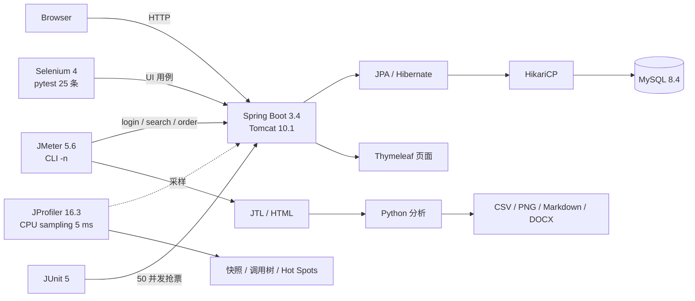
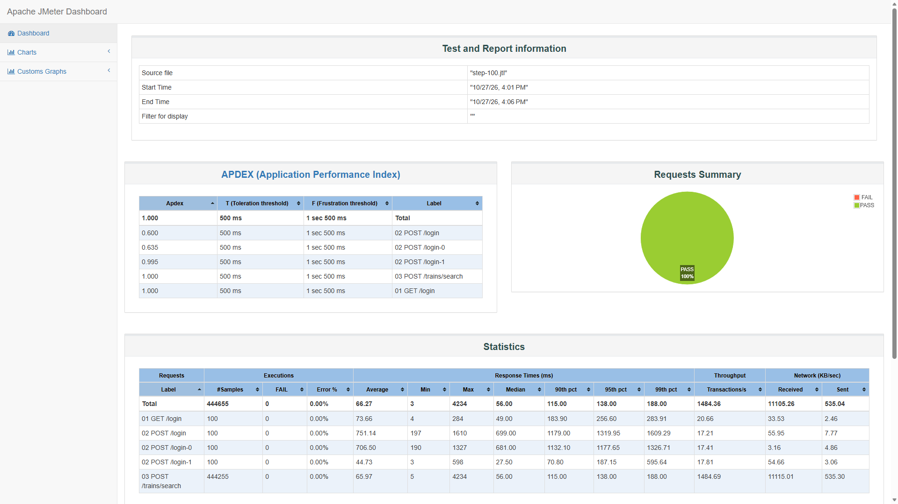
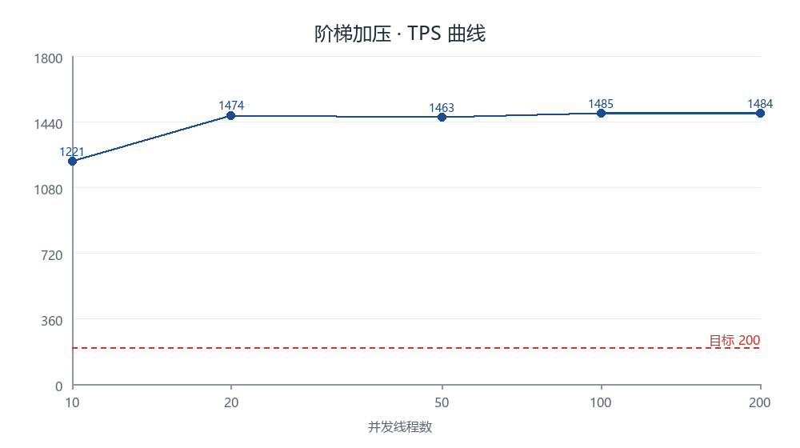
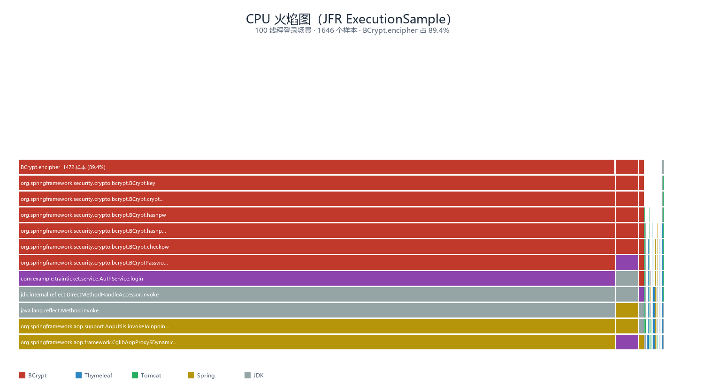

# 火车票预订系统 · 压力测试与性能剖析实践

### Spring Boot + MySQL 被测系统 · JMeter + JProfiler 性能测试 · JUnit + Selenium 自动化


一个**可复现**的火车票系统测试项目：自己造一套 Spring Boot + MySQL 被测系统，
用 JMeter 完成查询阶梯、混合查询+下单、登录对比和并发下单，用 JProfiler 采样定位 CPU 热点；
用 JUnit 验证 50 并发抢 10 张票不超卖；用 25 条 pytest + Selenium 覆盖登录/注册/查询/下单/退票/后台。
所有性能数字都能回到 JTL/CSV，并保留可复现的图表与证据链。

`快速开始` · `性能结果` · `数据库安装` · `测试设计` · `项目亮点` · `文档索引`

---

## 项目简介

一个完整的测试工程通常由几块拼图组成，这个项目把它们放进同一个仓库：

| 角色 | 是什么 | 在哪 |
|------|--------|------|
| 被测系统 | 火车票预订系统：登录 / 车次查询 / 下单 / 退票 / 管理后台 | `src/`、`db/` |
| 性能测试 | 4 个 JMeter 场景 + **JProfiler 16.3 CPU 采样** + 种子/复位 SQL + JTL/HTML + 分析脚本 | `perf/`、`docs/profiler/` |
| 功能自动化 | 25 条 pytest + Selenium 用例，覆盖成功与失败场景 | `functional_tests/` |
| 并发正确性 | JUnit 50 并发抢 10 张票；JMeter 同座位集合点下单 | `src/test/`、`perf/booking-concurrency.jmx` |
| 测试文档 | 方案、证据链、JMeter + JProfiler 操作手册 | `docs/` |
| 登录页 | 晴空列车动态场景，卡片透明度可配置（CSS 变量） | `app/`、`src/main/resources/static/login/` |

核心特点是**数据可追溯**：TPS、P95、CPU、错误率都能在 `perf/results/` 的
汇总 CSV / JTL / 采样文件里找到，CPU 热点能在 `docs/profiler/` 的快照与导出文件里复核；
脚本可以重新生成图表和证据文件。

## 架构



一次性能测试的链路：

1. `perf/00_perf_seed.sql` 初始化压测用户、线路、座位；`01_perf_reset.sql` 每轮复位
2. JMeter 用 `-n` 命令行执行场景，产出 JTL
3. `perf/analyze_*.py` 从 JTL/资源 CSV 计算 TPS、P90/P95/P99、错误率、CPU
4. `perf/plot_step_load.py` 等生成图表；`scripts/gen_perf_report_docx.py` 可在本地重新生成 Word 报告

## 目录结构

```text
train-ticket-java/
├── app/                         # 登录页设计稿与素材源
├── db/
│   ├── 00_create_database.sql   # 建库 + train_app 账号（密码用占位符）
│   ├── 01_schema.sql            # 表结构
│   └── 02_seed.sql              # 演示账号 / 车次 / 未来 3 天车票
├── docs/
│   ├── 数据库安装与初始化.md
│   ├── 性能测试方案.md
│   ├── JMeter与JProfiler操作手册.md
│   ├── IDEA验证指南.md
│   ├── figs/                     # 阶梯曲线、CPU/内存、火焰图、登录页截图
│   ├── profiler/                 # JProfiler 快照、CPU 调用树、Hot Spots
│   └── evidence/                 # 阶梯汇总、资源摘要、DB 状态、JFR、A/B
├── functional_tests/            # 25 条 pytest + Selenium
│   ├── test_login.py / test_register.py / test_search.py
│   ├── test_booking.py / test_refund.py / test_admin.py
│   ├── 00_test_seed.sql
│   └── run_tests.bat
├── perf/
│   ├── scenario-query.jmx       # 查询阶梯
│   ├── scenario-mixed.jmx       # 查询 + 下单
│   ├── load-test.jmx            # 登录+查询对比
│   ├── booking-concurrency.jmx  # 同座位集合点下单
│   ├── 00_perf_seed.sql / 01_perf_reset.sql / 02_perf_cleanup.sql
│   ├── data/                    # users / routes / booking CSV
│   ├── analyze_*.py / plot_*.py / summarize_*.py
│   ├── step-load.bat / run-load.bat / run-booking.bat
│   └── results/                 # 汇总 CSV/MD、小型 JTL、证据文件
├── scripts/                     # 生成 Word 报告 / 验证指南
├── src/main/java/...            # Controller / Service / Repository / Entity
├── src/main/resources/
│   ├── application.yml / application-h2.yml
│   ├── templates/               # login.html 等
│   └── static/                  # app.css、login.css、登录素材
├── src/test/java/.../BookingConcurrencyTest.java
├── .gitignore
├── pom.xml
└── README.md
```

> `perf/results/` 只保留汇总和小型证据；`step-*.jtl`、`html-*` 等大文件不入库，
> 运行 `perf/step-load.bat` 可重新生成。详见 `perf/README.md`。

## 快速开始

### 环境要求

| 依赖 | 版本 |
|------|------|
| JDK | 21 |
| Maven | 3.9+ |
| MySQL | 8.4（8.0+ 也可） |
| JMeter | 5.6.3（仅性能测试需要） |
| Python | 3.11+（Selenium / 分析脚本） |
| 浏览器 | Chrome 或 Edge（Selenium Manager 自动匹配驱动） |

### 1. 克隆项目

```bash
git clone https://github.com/hjxandcxq/train-ticket-test-platform.git
cd train-ticket-test-platform
```

### 2. 初始化数据库

完整步骤见 **[docs/数据库安装与初始化.md](docs/数据库安装与初始化.md)**。最短路径：

```bash
# 先把 db/00_create_database.sql 里的 __DB_PASSWORD__ 替换成本机密码
mysql -u root -p < db/00_create_database.sql
mysql -u train_app -p train_ticket < db/01_schema.sql
mysql -u train_app -p train_ticket < db/02_seed.sql
```

### 3. 配置数据库环境变量

```bat
rem Windows cmd
set DB_USERNAME=train_app
set DB_PASSWORD=你的本机密码
```

```powershell
# PowerShell
$env:DB_USERNAME = "train_app"
$env:DB_PASSWORD = "你的本机密码"
```

```bash
# macOS / Linux
export DB_USERNAME=train_app
export DB_PASSWORD='你的本机密码'
```

也可以直接在 IDEA 运行配置的 **Environment variables** 里填写。
仓库不包含 `.run/`（本地 IDE 配置）和任何真实密码。

### 4. 启动应用

```bash
mvn spring-boot:run
```

或者在 IDEA 里运行 `TrainTicketApplication`。打开：

```text
http://localhost:8080/login
```

### 5. 不装 MySQL 的 H2 演示模式

```bash
mvn spring-boot:run -Dspring-boot.run.profiles=h2
```

H2 启动时自动建表并写入演示数据，退出即清空。**只适合看页面/写脚本，不适合正式压测。**

### 演示账号

| 账号 | 密码 | 角色 |
|------|------|------|
| alice01 | Pass123 | 普通用户 |
| bob01 | Pass123 | 普通用户 |
| admin | admin123 | 管理员 |

> 这些是自建演示系统的固定测试账号，仅用于本地演示和自动化测试。

### 登录页

登录页使用 `app/` 的「晴空列车」素材，运行时复制到 `src/main/resources/static/login/assets/`。
卡片透明度通过 CSS 变量 `--card-alpha` 配置（默认 0.88）；云层/列车动画由 CSS 实现，
`prefers-reduced-motion` 下自动暂停。截图见下方「图片展示」。

## 测试设计

### JMeter 场景

| 场景 | 并发 / 循环 | 时长 | 目的 |
|------|-------------|------|------|
| 查询阶梯 | 10 / 20 / 50 / 100 / 200 | 每档 5 分钟 | 找 TPS 平台与延迟拐点 |
| 混合查询+下单 | 50 查询 + 10 下单 | 60 秒 | 验证混合负载下无错误、下单成功 |
| 登录+查询对比 | 50 × 100 圈 | 约 102 秒 | 量化 BCrypt 登录代价 |
| 并发下单 | 10，集合点 | 约 1 秒 | 同座位并发，验证库存扣减 |

脚本包含 CSV 参数化、Cookie 复用、响应断言、命令行执行；详细命令见
[perf/README.md](perf/README.md)。

### JProfiler 采样

JProfiler 16.3 通过本地 Attach 连到运行中的 JVM，CPU sampling 5 ms，
对 **50 线程 × 300 圈登录+查询** 采样约 5 分钟：

- 快照：`docs/profiler/login-5min.jps`
- CPU 调用树：`docs/profiler/cpu-calltree.html`（`HTTP: /login` 占 92.1%）
- Hot Spots：`docs/profiler/cpu-hotspots.csv`（`BCryptPasswordEncoder.matches` 91.2%）
- GUI 连接四步与截图点：[docs/JMeter与JProfiler操作手册.md](docs/JMeter与JProfiler操作手册.md)

### JUnit 并发正确性

`BookingConcurrencyTest`：余票 10 张，50 个并发请求，断言：

- 成功 10 单、40 个「余票不足」
- 库存最终为 0
- 订单正好 10 条
- 退票后库存回补，重复退票被拒绝

> 该用例运行在 H2 上，验证的是原子 `UPDATE ... WHERE stock > 0` 语义；
> MySQL 行锁行为建议另补一条同场景用例。

### Selenium 功能自动化

25 条用例覆盖登录、注册、查询、下单、退票、后台，成功和失败场景都有：

```bat
python -m venv .venv-tests
.venv-tests\Scripts\pip install -r functional_tests\requirements.txt
rem 新建 functional_tests\.env，填写 DB_HOST / DB_USERNAME / DB_PASSWORD
functional_tests\run_tests.bat
```

预期：**25 passed**。测试套件启动前会自动执行 `00_test_seed.sql`，重置 `FUNC01` 车次。

## 性能结果

### 查询阶梯（每档 5 分钟）

| 线程数 | 查询请求数 | TPS | 平均(ms) | P95(ms) | P99(ms) | 错误率 |
|---|---|---|---|---|---|---|
| 10（基准） | 365,708 | 1,221.2 | 7.4 | 10 | 14 | 0% |
| 20 | 441,367 | 1,473.9 | 12.7 | 25 | 35 | 0% |
| 50 | 437,428 | 1,463.1 | 33.1 | 68 | 92 | 0% |
| 100 | 444,255 | 1,484.7 | 66.0 | 140 | 194 | 0% |
| 200 | 442,552 | 1,484.1 | 132.7 | 295 | 417 | 0% |

- 20 线程后 TPS 进入约 **1,460–1,485** 的平台，平均响应从 12.7 ms 涨到 132.7 ms
- 五档共 **2,131,310** 个查询，错误率 0%

### 登录、混合与并发

| 场景 | 结果 |
|------|------|
| 登录+查询（50 线程持续） | 主请求 TPS 147.6，折合 **49.2 次登录+查询/秒**；P95 1,024 ms |
| 混合（50 查询 + 10 下单） | TPS 535.4，平均 89.7 ms，P95 166 ms，0 错误；10 单成功 |
| 并发下单（同座位） | 10 单成功，库存 1000 → 990 |
| JUnit 50 抢 10 | 成功 10 单、40 个余票不足、库存 0、未超卖 |

### JProfiler 采样：登录瓶颈在 BCrypt

JProfiler 16.3 以 CPU sampling（5 ms）对 **50 线程 × 300 圈登录+查询** 采样约 5 分钟：

| 证据 | 文件 | 结果 |
|---|---|---|
| CPU 调用树 | [docs/profiler/cpu-calltree.html](docs/profiler/cpu-calltree.html) | `HTTP: /login` 占 92.1% |
| 热点明细 | [docs/profiler/cpu-hotspots.csv](docs/profiler/cpu-hotspots.csv) | `BCryptPasswordEncoder.matches` 自耗时 **91.2%** |
| 会话快照 | [docs/profiler/login-5min.jps](docs/profiler/login-5min.jps) | 50 线程 × 300 圈，错误率 0% |
| JFR 火焰图 | [docs/figs/cpu-flamegraph-jfr.png](docs/figs/cpu-flamegraph-jfr.png) | BCrypt 占 89.4%，与 JProfiler 相互印证 |

复现步骤见 [docs/profiler/README.md](docs/profiler/README.md)；
GUI 的 Attach 流程、采样时长和截图点见
[docs/JMeter与JProfiler操作手册.md](docs/JMeter与JProfiler操作手册.md)。

> JProfiler 的 Telemetry（CPU/内存实时曲线）在纯命令行控制下导不出数据，
> 仓库用 PowerShell 资源采样（`docs/figs/resource-cpu.png`、`resource-mem.png`）和 JFR 替代；
> 需要实时曲线时按操作手册用 GUI 会话现场录制。

### 连接池 A/B：主动推翻一个假设

查询平台期最初怀疑是 HikariCP 默认 10 连接上限（`10 ÷ 6.74ms ≈ 1483 TPS`，与实测吻合）。
于是把连接池从 10 扩到 30，同机、同数据、同样 `thymeleaf.cache=false` 做 A/B：

| 连接池 | 线程 | 稳态 TPS | 平均(ms) | P95(ms) | 应用 CPU | MySQL CPU |
|---|---|---|---|---|---|---|
| 10 | 50 | 1,471.6 | 33.2 | 75 | 34.4% | 20.0% |
| 30 | 50 | **1,573.4（+6.9%）** | 30.8 | 83 | 35.2% | 21.2% |
| 10 | 100 | 1,503.8 | 65.8 | 163 | 34.5% | 20.8% |
| 30 | 100 | **1,590.7（+5.8%）** | 61.9 | 162 | 35.2% | 21.3% |

结论：**扩池只带来约 6% 提升，连接池不是平台期主限制器**；之前“10 连接 ≈ 1483 TPS”只是数字巧合。
剩余最可能是同机 JMeter 客户端（本轮未采客户端 CPU），其次是应用 CPU/模板渲染。
完整数据见 [docs/evidence/pool-ab.md](docs/evidence/pool-ab.md)。

### 结论与边界

- 查询/混合的功能链路可用；登录是唯一不达标场景，瓶颈是 BCrypt（JProfiler 91.2% / JFR 89.4% CPU）
- **1,485 只能叫“同机压测配置下的实测平台”，不能叫系统容量**
- 单机、同压、小数据集、无思考时间；结果不外推到生产
- 测试方案：[docs/性能测试方案.md](docs/性能测试方案.md) ·
  原始证据：[docs/evidence/](docs/evidence/)（完整测试报告暂未公开）

## 项目亮点

| 亮点 | 证据 |
|------|------|
| 真实业务约束，不是 CRUD demo | 下单用 `UPDATE ... WHERE stock > 0` 原子扣减；JUnit 50 抢 10 不超卖 |
| 测试链路完整 | JMeter 4 个场景 + JProfiler CPU 采样 + 25 条 Selenium + 2 条 JUnit + 图表/证据 |
| 每个数字可追溯 | JTL/CSV → 图表 → 证据；JProfiler 快照 → 调用树 → 热点 CSV；`perf/analyze_*.py` 可重算 |
| 有实验精神 | 连接池 A/B 主动推翻“10 连接上限”的初始假设，并保留否定结论 |
| AI 辅助 + 人工复核 | AI 生成/修改 JMX、分析、图表和报告初稿；所有数字回原始 JTL 复核 |
| 可教学、可复现 | 中文文档、seed/reset SQL、H2 演示、脚本化命令 |
| 展示效果 | 动态登录页、可配置卡片透明度、JMeter HTML 报告、JProfiler 快照/Hot Spots、JFR 火焰图 |

## 图片展示

登录页（动态场景 + 可调透明度）：


JMeter 原生 HTML 报告（100 线程档）：



查询阶梯 TPS 曲线：



JFR CPU 火焰图（BCrypt 占 89.4%，与 JProfiler 的 91.2% 相互印证）：



## 文档索引

| 文档 | 内容 |
|------|------|
| [docs/数据库安装与初始化.md](docs/数据库安装与初始化.md) | MySQL 安装、建库/账号、建表/种子、环境变量、常见问题 |
| [docs/性能测试方案.md](docs/性能测试方案.md) | 目标、范围、环境、数据、场景、指标、执行规范 |
| [docs/JMeter与JProfiler操作手册.md](docs/JMeter与JProfiler操作手册.md) | JMeter + JProfiler 完整操作手册：PPT 口径、逐节点动作与耗时 |
| [docs/IDEA验证指南.md](docs/IDEA验证指南.md) | 在 IDEA 里复现功能测试、性能数据和图表 |
| [perf/README.md](perf/README.md) | JMeter 脚本、数据、执行命令、结果说明 |
| [functional_tests/README.md](functional_tests/README.md) | 25 条 Selenium 用例清单与运行方式 |
| [docs/profiler/README.md](docs/profiler/README.md) | JProfiler 快照、CPU 调用树、热点明细与复现命令 |
| [docs/evidence/](docs/evidence/) | 阶梯汇总、资源摘要、DB 状态、JFR、连接池 A/B |

> 完整《性能测试报告》（md / docx）暂未公开；报告中的结论与原始数据仍可从
> `docs/evidence/`、`docs/figs/` 和 `perf/` 下的脚本复现。

## 常见问题

**Q：数据库连接报 `Access denied`？**
检查 `DB_USERNAME`/`DB_PASSWORD`，以及是否创建了 `'train_app'@'127.0.0.1'`。
完整排查见 [docs/数据库安装与初始化.md](docs/数据库安装与初始化.md)。

**Q：没有 MySQL 能跑吗？**
可以先用 H2 看页面：`mvn spring-boot:run -Dspring-boot.run.profiles=h2`。
但性能测试必须用 MySQL，H2 结果不可比。

**Q：JMeter 找不到？**
设置 `JMETER_HOME`，例如：

```bat
set JMETER_HOME=C:\apache-jmeter-5.6.3
perf\step-load.bat
```

**Q：为什么仓库里没有 `step-*.jtl` 和 `html-step-*`？**
单档 JTL 约 60 MB，HTML 报告还带前端资源；仓库只保留汇总 CSV/MD 和截图。
运行 `perf/step-load.bat` 会重新生成。

**Q：为什么 50 线程混合场景是 535 TPS，阶梯 50 档是 1463？**
两次执行时间、JVM 状态和运行时长不同；混合场景只有 60 秒，主要用于验证混合负载下无错误，
不作为容量数字。报告 §7.3 已注明。

**Q：CSV 参数化怎么保证多账号？**
`users.csv` / `booking.csv` 已改为 `shareMode=group`：登录在 Once Only、下单单圈时，
每个线程取下一行，10 线程会分到 `perf01`–`perf10` / 不同座位。
历史报告的数字是修复前单账号口径，详见报告 §7.7。

**Q：登录页改版后性能数据还对吗？**
报告数据采集于改版前登录页（commit `f56cd15` / v1.0.0）；UI 改版只改变 `GET /login` 的
HTML/CSS/JS 体积，JMeter 默认不加载图片，`POST /login` 的 BCrypt 结论不受影响。
如果重跑登录场景，`GET /login` 的绝对耗时可能略有变化。

**Q：为什么 TPS 这么高，目标才 200？**
查询是轻量只读接口、无思考时间、小数据集；1,485 是容量上限，不是真实业务吞吐。
真实登录+查询只有 49.2 次/秒。

## 贡献

欢迎提 Issue / PR。改动测试数据或报告时，请保持“脚本 → JTL/CSV → 图表/报告”链路一致：

```bash
python perf/summarize_step_load.py
python perf/plot_step_load.py
python perf/analyze_timeseries.py --jtl perf/results/step-100.jtl --prefix step-100
python perf/analyze_resources.py
```

提交前确认没有把 `.env`、`.run/`、数据库密码或个人文档带进 Git。

## 许可

本项目采用 [MIT License](LICENSE)。

## 免责声明与安全说明

火车票预订系统是为教学与测试演练而**自建**的简易系统，不是真实售票系统，
不涉及真实支付、真实用户或真实资金；仓库中的账号、车次、订单、库存全部为虚构数据。

**安全说明**：

- 仓库不包含任何真实数据库密码、API Key、令牌或第三方服务凭据。
- 数据库密码通过 `DB_PASSWORD` 环境变量传入；`.env`、`.run/`、`perf/temp/`
  和个人版数据库操作文档都在 `.gitignore` 中。
- `db/00_create_database.sql` 使用 `__DB_PASSWORD__` 占位符，首次安装时必须替换。
- `alice01/Pass123`、`admin/admin123`、`perf01/Pass123` 是自建演示系统的固定测试账号，
  仅用于本机演示与自动化测试，请勿用于生产环境。
- 性能数据来自单机、同机压测和有限数据集，不代表生产容量。
